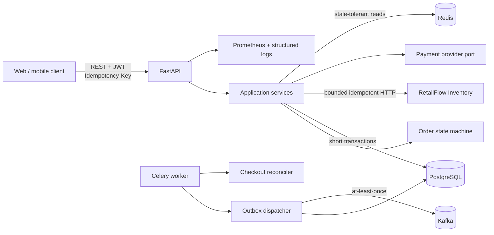
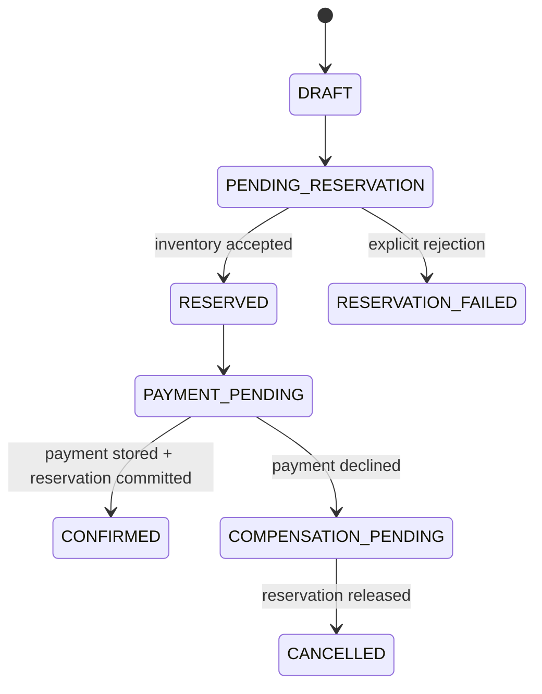

# RetailFlow Orders

[](https://github.com/vladimirDev23/retailflow-orders/actions/workflows/ci.yml)
[](https://github.com/vladimirDev23/retailflow-orders/actions/workflows/security.yml)
[](https://www.python.org/)
[](https://fastapi.tiangolo.com/)
[](LICENSE)

RetailFlow Orders is a production-minded order orchestration and checkout service. It
coordinates inventory reservations and payment decisions while keeping retries safe,
state transitions auditable, and integration events recoverable.

This is the Python flagship in the RetailFlow portfolio. It consumes the reservation
contract published by
[RetailFlow Inventory](https://github.com/vladimirDev23/retailflow-inventory), the Java
service that owns stock.

## What it demonstrates

| Capability | Implementation |
| --- | --- |
| Explicit workflow | Domain state machine with guarded transitions and immutable price snapshots |
| Cross-service consistency | Saga-style checkout with inventory release after payment decline |
| Payment-safe recovery | Provider approval is persisted before the reservation commit is retried |
| Safe client retries | Durable request fingerprints, leases, resource binding, and response replay |
| Reliable events | PostgreSQL transactional outbox, `SKIP LOCKED`, idempotent Kafka producer |
| Async I/O | FastAPI, SQLAlchemy 2 async sessions, asyncpg, Redis, and HTTPX2 |
| Security | Argon2 passwords, scoped JWT claims, generic auth failures, secret-history scanning |
| Operations | Liveness/readiness, Prometheus metrics, correlation IDs, structured logs, Celery workers |
| Delivery quality | Strict MyPy, Ruff security rules, coverage gate, Testcontainers, Compose smoke test |

## Architecture



The code follows a ports-and-adapters boundary:

```text
src/retailflow_orders
├── api/                 REST contracts and problem responses
├── application/         use cases, ports, idempotent facade, reconciliation
├── domain/              order aggregate, state transitions, domain events
└── infrastructure/      PostgreSQL, Redis, JWT, HTTP, Kafka, Celery adapters
```

External HTTP calls never run inside a database transaction. PostgreSQL owns durable
workflow state; Redis only accelerates product-snapshot reads. See
[Architecture Decision Records](docs/adr/README.md) for the tradeoffs.

## Checkout workflow



The difficult recovery case is an approved payment followed by an uncertain Inventory
commit. The service first persists the provider reference and its outbox event. A retry
or background reconciliation then reuses the stable Inventory idempotency key and does
not charge again. An uncertain reservation response remains client-retryable because no
payment method is stored before that point.

## Quick start

### Requirements

- Docker with Compose v2
- `curl` and `jq` for the smoke test
- optional: Python 3.13 and [uv](https://docs.astral.sh/uv/) for local development

Create a local environment file:

```bash
cp .env.example .env
```

Replace every placeholder. Generate the JWT key, for example, with:

```bash
openssl rand -base64 48
```

Start PostgreSQL, Redis, Kafka, the API, Celery worker/beat, and the development Inventory
contract stub:

```bash
docker compose up --build --detach
./scripts/smoke-test.sh
```

The smoke test verifies authentication, create-order replay, approved checkout,
declined-payment compensation, and the final Kafka outbox event.

Useful URLs:

- Swagger UI: <http://localhost:8000/docs>
- OpenAPI JSON: <http://localhost:8000/openapi.json>
- Liveness: <http://localhost:8000/api/v1/health/live>
- Readiness: <http://localhost:8000/api/v1/health/ready>
- Prometheus metrics: <http://localhost:8000/metrics>

Stop the stack:

```bash
docker compose down
```

Add `--volumes` only when intentionally deleting the local PostgreSQL data.

### Demo data

Startup migrations seed one local admin and one non-sensitive product snapshot:

| Item | Value |
| --- | --- |
| Login | value of `ADMIN_EMAIL` and `ADMIN_PASSWORD` from `.env` |
| Product ID | `33333333-3333-4333-8333-333333333333` |
| Warehouse ID | `22222222-2222-4222-8222-222222222222` |
| Approved method | `pm_demo_approved` |
| Declined method | `pm_demo_declined` |

`dev_support/inventory_stub.py` implements only the published reservation contract. It is
for a deterministic local stack, not a production substitute for RetailFlow Inventory.

## API overview

All write endpoints require an `Idempotency-Key` containing 8–128 safe ASCII characters.
Authenticated requests use `Authorization: Bearer <token>`.

| Method | Path | Purpose |
| --- | --- | --- |
| `POST` | `/api/v1/auth/token` | Exchange local credentials for a short-lived JWT |
| `POST` | `/api/v1/orders` | Create an order from server-owned product snapshots |
| `POST` | `/api/v1/orders/{id}/checkout` | Run or resume the checkout saga |
| `GET` | `/api/v1/orders/{id}` | Read one customer-owned order |
| `GET` | `/api/v1/orders` | List customer orders with status filter and pagination |

Example:

```bash
token="$(
  curl --silent --request POST http://localhost:8000/api/v1/auth/token \
    --header 'Content-Type: application/json' \
    --data '{"email":"admin@example.com","password":"<ADMIN_PASSWORD>"}' |
  jq --raw-output '.accessToken'
)"

curl --request POST http://localhost:8000/api/v1/orders \
  --header "Authorization: Bearer ${token}" \
  --header 'Idempotency-Key: readme-create-100' \
  --header 'Content-Type: application/json' \
  --data '{
    "warehouseId":"22222222-2222-4222-8222-222222222222",
    "lines":[{
      "productId":"33333333-3333-4333-8333-333333333333",
      "quantity":2
    }]
  }'
```

The generated OpenAPI document is the authoritative field-level contract. For a complete
executable flow, read [`scripts/smoke-test.sh`](scripts/smoke-test.sh).

### Error contract

Failures use a stable problem document containing `type`, `title`, HTTP `status`,
human-readable `detail`, machine-readable `code`, and `correlationId`. Authentication
errors do not reveal whether an email exists. Uncertain downstream outcomes return
`503` and preserve a recoverable order state instead of guessing success or failure.

## Security model

- Passwords are hashed with the recommended Argon2 profile.
- JWTs validate issuer, audience, expiry, subject, email, and role.
- Product price and availability come from a server-side snapshot, never the order
  request.
- Downstream tokens are not included in exception messages or API responses.
- `.env`, private keys, credentials, IDE state, caches, logs, and build output are
  excluded from Git and Docker contexts.
- CI scans the complete Git history with Gitleaks and audits the hashed runtime
  dependency export from `uv.lock`.

The local HS256 issuer and deterministic payment adapter are portfolio boundaries. A
production deployment should use external OIDC/JWKS and a certified payment provider.
See [SECURITY.md](SECURITY.md).

## Configuration

| Variable | Purpose |
| --- | --- |
| `DATABASE_URL` | asyncpg PostgreSQL connection URL |
| `REDIS_URL` | product snapshot cache |
| `CELERY_BROKER_URL` | Celery broker |
| `CELERY_RESULT_BACKEND` | Celery task result store |
| `KAFKA_BOOTSTRAP_SERVERS` | Kafka brokers |
| `KAFKA_ORDER_EVENTS_TOPIC` | outbox destination |
| `INVENTORY_BASE_URL` | Inventory reservation API |
| `INVENTORY_SERVICE_TOKEN` | machine-to-machine bearer token |
| `JWT_SECRET` | HS256 key, at least 32 characters |
| `ADMIN_EMAIL`, `ADMIN_PASSWORD` | disposable local identity |

Every supported variable and placeholder is listed in [`.env.example`](.env.example).

## Quality gates

```bash
uv sync --frozen --extra dev
uv run ruff check src tests alembic dev_support scripts
uv run mypy src tests dev_support scripts
uv run pytest -m "not integration" --cov=retailflow_orders --cov-report=term-missing
uv run pytest -m integration
uv run alembic upgrade head --sql
uv build
```

Integration tests require Docker. They use real PostgreSQL 17, Redis 8, and Kafka
containers to verify:

- migration upgrade, downgrade, and clean reapplication;
- atomic order and outbox persistence;
- Redis connectivity and expiry-capable writes;
- Kafka payload delivery with a stable aggregate key.

The local fast suite enforces 85% aggregate branch-aware coverage. GitHub Actions runs
all static, unit, integration, package, container, secret, and dependency gates.

## Observability and operations

- Liveness is process-only; readiness checks PostgreSQL and Redis.
- Every request accepts or receives an `X-Correlation-ID`.
- HTTP completion logs are structured and include status and duration.
- Prometheus middleware exports request metrics at `/metrics`.
- Outbox rows retain attempt count and the last delivery error.
- Recoverable payment/compensation states are periodically reconciled.

Operational checks and failure procedures are in [docs/runbook.md](docs/runbook.md).

## Important limitations

- Checkout is an orchestrated saga, not a distributed ACID transaction.
- Kafka delivery is at-least-once; consumers must deduplicate by `eventId`.
- The product projection is seeded locally; a production catalog consumer is outside the
  current scope.
- Redis cache invalidation is TTL-based and intentionally allowed to be stale.
- One Celery beat scheduler must own the periodic schedule.
- Local identity, payment, and Inventory stub implementations are not production
  integrations.
- Multi-region active-active operation and disaster recovery are not implemented.

## Documentation

- [Architecture details](docs/architecture.md)
- [Architecture decisions](docs/adr/README.md)
- [Operational runbook](docs/runbook.md)
- [Contribution guide](CONTRIBUTING.md)
- [Resume evidence](RESUME_NOTES.md)
- [Change log](CHANGELOG.md)

## License

Licensed under the [MIT License](LICENSE).
