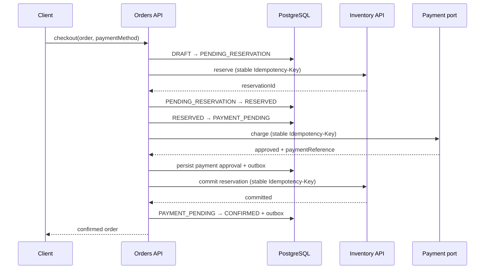

# Architecture

## Consistency boundaries

PostgreSQL is the source of truth for orders, price snapshots, idempotency records,
transition history, and outbox events. A local transaction may update several of those
tables, but it never spans Inventory, a payment provider, Redis, or Kafka.

The checkout application service coordinates external calls between short database
transactions:

If payment is declined, the order moves to `COMPENSATION_PENDING`, Inventory releases
the reservation, and the order becomes `CANCELLED`. If a downstream timeout makes the
outcome uncertain, the durable state stays non-terminal and the API returns a retryable
dependency error.

## Idempotency

The API hashes a canonical JSON payload and stores only the SHA-256 request fingerprint,
not the original secret-bearing body. A `(scope, key_hash)` constraint provides durable
uniqueness. Records bind a key to one resource, use a short execution lease, and retain
the completed response metadata for deterministic replay.

Each downstream operation derives its own stable key from the order ID and operation
name. Bounded HTTP retries are allowed only for those idempotent calls.

## Messaging

Domain changes append an outbox row in the same transaction as the order update. Celery
workers claim rows using `FOR UPDATE SKIP LOCKED`, commit a delivery lease, publish
outside the database transaction, and mark only acknowledged messages as published.

The Kafka producer enables idempotence, but end-to-end delivery remains at-least-once
because the process can stop after Kafka acknowledges and before PostgreSQL records that
acknowledgement. Consumers must deduplicate by `eventId`.

## Cache

Redis caches catalog snapshots only. Cache failures fall back to PostgreSQL, malformed
entries are ignored, and TTL bounds staleness. Orders, state transitions, idempotency,
payment references, and outbox state are never authoritative in Redis.

## Dependency direction

The domain imports no framework. Application services depend on protocols from the
application boundary. Infrastructure implements those protocols with SQLAlchemy, Redis,
HTTPX2, Kafka, and JWT libraries. FastAPI translates HTTP contracts into application
commands.
